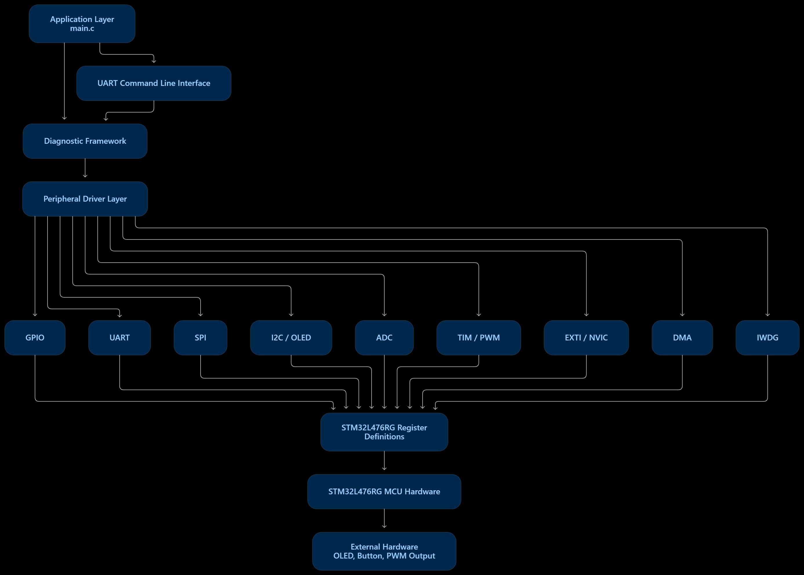
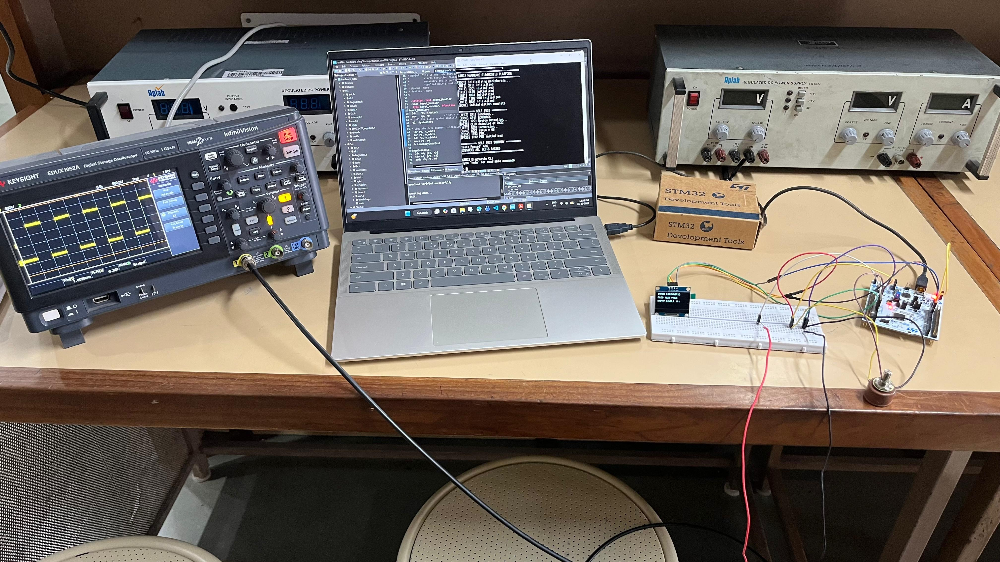
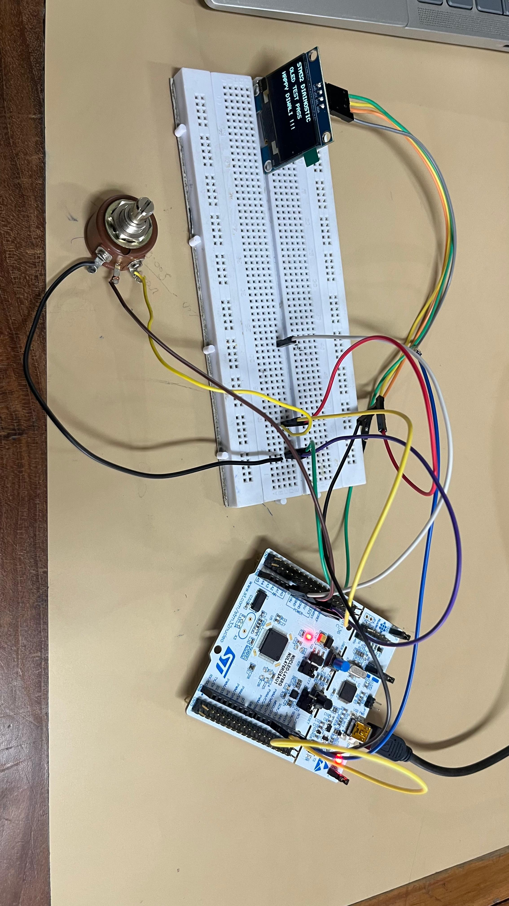
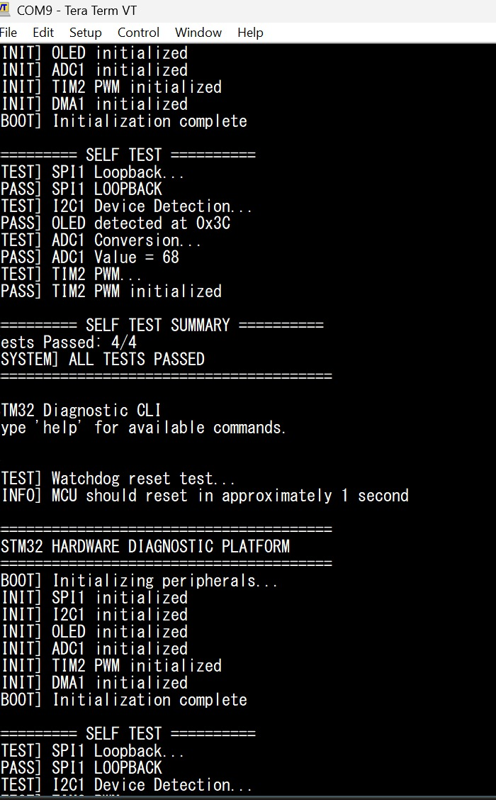
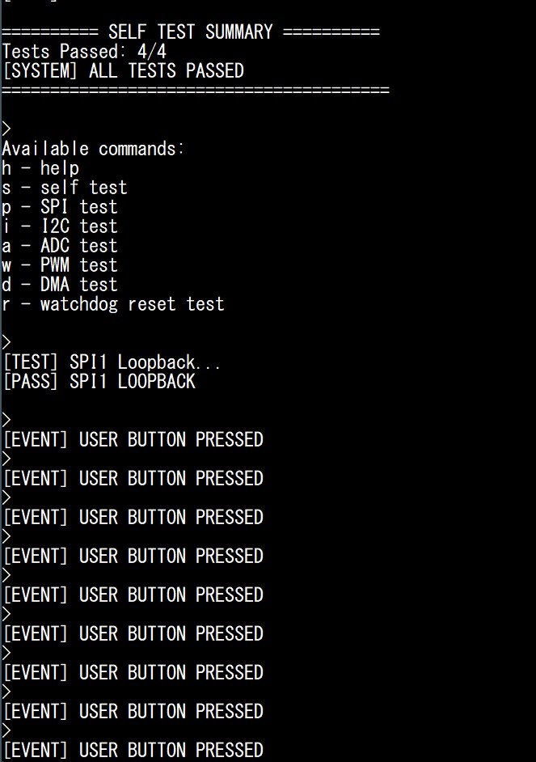
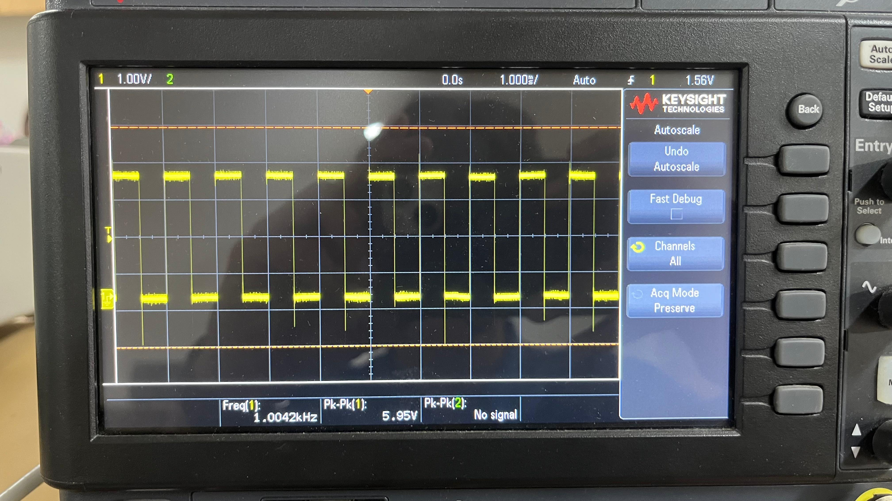
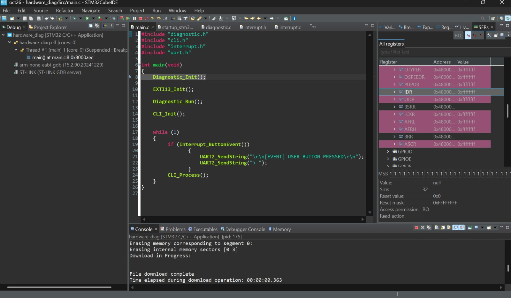

# STM32 Hardware Diagnostics & Firmware Platform

A register-level firmware project for the **STM32L476RG (NUCLEO-L476RG)**. It implements reusable peripheral drivers and a UART diagnostic CLI to exercise MCU interfaces and verify behavior on hardware.

## Hardware

- NUCLEO-L476RG development board
- On-board ST-LINK and ST-LINK Virtual COM Port
- Tera Term serial terminal (9600 baud, 8-N-1)
- 1.3-inch 128×64 I2C OLED (detected at address `0x3C`)
- Oscilloscope for PWM verification
- Jumper wire for SPI MOSI-to-MISO loopback

## Implemented modules

| Peripheral | Demonstration | Verification performed |
|---|---|---|
| GPIO | PA5 output control | Output toggling |
| UART2 | Serial transmit/receive and CLI | Tera Term |
| SPI1 | Master-mode transfer | MOSI-to-MISO loopback passed |
| I2C1 | Device address detection | OLED detected at `0x3C` |
| OLED | I2C text display | Diagnostic text displayed |
| ADC1 | Single conversion on PA0 / ADC1_IN5 | Conversion values read over UART |
| TIM2 PWM | PWM output on PA1 / TIM2_CH2 | Oscilloscope verified |
| EXTI13 | PC13 falling-edge button interrupt | Button event received over UART |
| DMA1 | Channel 1 memory-to-memory transfer | Destination buffer verified |
| IWDG | Watchdog timeout test | MCU reset observed |

The table records tests performed during development; it is not a claim of formal production qualification.

## Firmware architecture

```text
main.c application
  ├── UART command-line interface
  ├── Diagnostic framework
  │     ├── Startup self-test
  │     └── Individual peripheral tests
  └── Peripheral drivers
        ├── GPIO / UART
        ├── SPI / I2C / OLED
        ├── ADC / TIM2 PWM
        ├── EXTI / NVIC
        ├── DMA
        └── Independent watchdog
              └── STM32L476RG memory-mapped registers
```

## 📚 Documentation

- [Pin Configuration & Hardware Connections](docs/pin_connections.md)
- [Testing Procedures & Verification Results](docs/testing_procedure.md)


## Register-Level Firmware Architecture & Peripheral Interaction


## 📸 Hardware Demonstrations

### 1. Complete Hardware Setup

<p align="center">
  
  
</p>

### 2. UART Diagnostic CLI

<p align="center">
  
  
</p>

### 3. PWM Signal Verification

<p align="center">
  
</p>

### 4. Register-Level Debugging

<p align="center">
  
</p>

## CLI commands

| Key | Action |
|---|---|
| `h` | Help |
| `s` | Run self-test |
| `p` | SPI loopback test |
| `i` | I2C OLED detection |
| `a` | Read ADC conversion |
| `w` | PWM test status |
| `d` | DMA memory-transfer test |
| `r` | Watchdog reset test |

Serial settings: **9600 baud, 8 data bits, no parity, 1 stop bit, no flow control**.

## Wiring

### OLED / I2C1

| OLED pin | NUCLEO-L476RG |
|---|---|
| VCC | 3.3 V |
| GND | GND |
| SCL | D15 / PB8 |
| SDA | D14 / PB9 |

### SPI1 loopback

Connect **D11 / PA7 (MOSI)** to **D12 / PA6 (MISO)**. SCK is **D13 / PA5**.

### PWM

TIM2_CH2 output is configured on **PA1**.

### User button interrupt

The user-button input is configured on **PC13** using EXTI13 with a falling-edge trigger.

## Build and flash

1. Open the STM32CubeIDE project targeting STM32L476RG.
2. Build the project.
3. Connect the board over USB and flash using the on-board ST-LINK.
4. Open the ST-LINK Virtual COM Port in a serial terminal using the settings above.
5. Run the CLI commands to exercise the modules.

The project uses direct register access through `Inc/stm32l476_registers.h`, rather than STM32 HAL calls. Include the STM32L476 startup file and linker script in the IDE project.

## Debugging workflow

- Check peripheral clock-enable bits.
- Inspect GPIO mode and alternate-function registers.
- Inspect peripheral control and status registers through STM32CubeIDE's SFR view.
- Verify wiring and signal behavior with suitable test equipment.
- Correlate register state with UART diagnostics and hardware observations.


## Repository layout

```text
Inc/       Header files
Src/       Peripheral drivers and application source
Startup/   Cortex-M startup and interrupt vector code
README.md  Project overview, setup and verification notes
```

## Possible extensions

Structured fault logging, reset-cause reporting, and ADC transfers using DMA are possible follow-on improvements.

## Author

**Tanmay Bindal** · [GitHub](https://github.com/bindal-tanmay)
